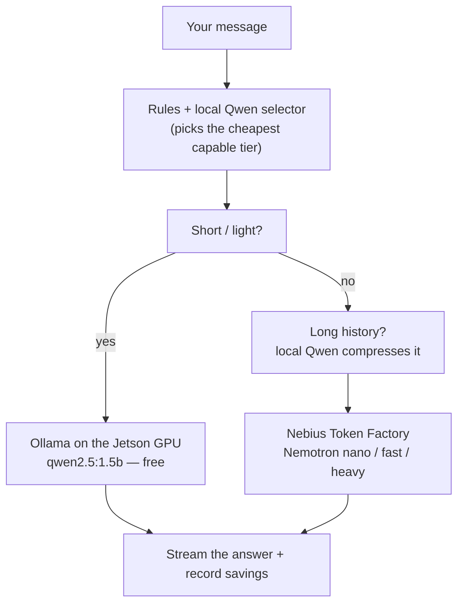
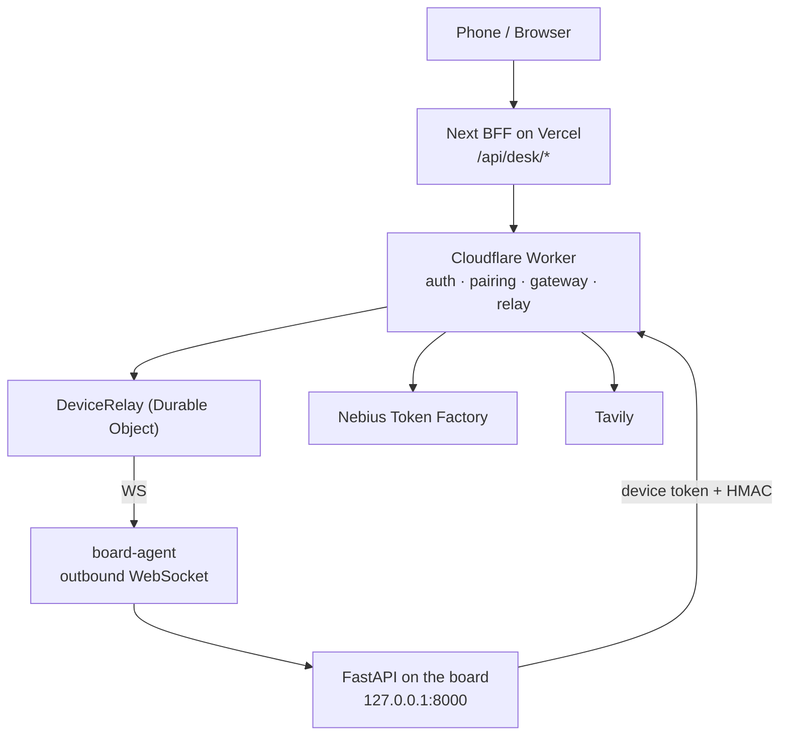
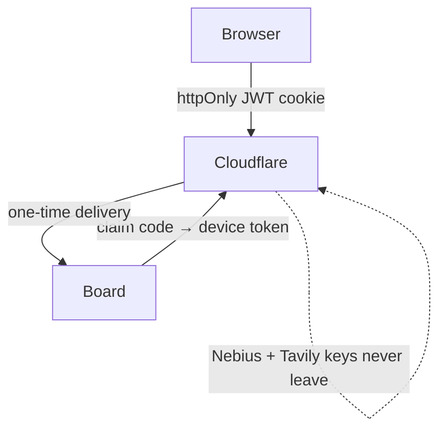

<p align="center">
  
</p>

<h1 align="center">Nebius Desk</h1>

<p align="center">
  A Claude-style operator desk whose brain lives on <strong>your</strong> NVIDIA Jetson.
  Chat drives the shell, files, browser, and background jobs on the box — light work
  stays local, hard work goes to Nebius.
</p>


## Signing in

Operators sign in once and land straight on their desk. The desk remembers your boards,
your last chat, and where you left the machine — no configuration.


## The desk

One surface for the whole machine: a chat on the left, live board context on the right,
and the board itself — health, shell, files, services, agents — one click away. The model
sees real observations from the box, not a mock.


## Millie, the desk guide

Millie is the little guide living in the corner of the desk. She is not a second chatbot:
she knows the product, answers in your language, and can actually drive the screen for you.
Ask her to open the terminal, find the secrets, or switch boards — she navigates there
herself and points at the exact control she means. Drag her anywhere; she remembers where
you left her.


New here? Type `/tour` — or just say *introduce yourself* — and she walks you through the desk step
by step (boards, chat, model tiers, the machine shell, secrets, credits), lighting up each
control as she talks. `/autotour` does the same hands-free.


She always runs on the cheapest cloud tier (`nano`) and can only ever touch an allowlisted
set of UI actions: open a screen, highlight a control, react. She never runs shell, never
writes files, and never sends chat on your behalf.

## The one idea

Most chat apps pick one model and bill every token. Nebius Desk treats the Jetson as a
**ladder**: a small local model answers free when it can, picks the cheapest cloud tier
when it can't, and **shrinks the prompt** before paid tokens ever leave the board. The
GPU you already own becomes the cost control plane.



Leave it on `Auto` and the router decides per turn — or pin a tier by hand from the model
picker in the composer:


## Why a physical Jetson is the product

- **Split-plane inference.** The edge answers, routes, and compresses; the cloud is
  rented only after the edge admits the request. Cost is a routing policy on silicon you own.
- **Data locality.** Desk tools run next to the board. The model sees observations, not a
  remote filesystem mount.
- **No inbound ports.** The board dials **out** to a Cloudflare relay, so it works behind
  home/lab NAT. Pairing is a short claim code, not an exposed `:8000`.
- **Real machine context.** Health, GPU, RAM, disk, per-board memory, and shell tools all
  come from the actual device — not a mock.

## What the agent can do on the board

The model asks for actions with fenced blocks; each one runs on the board (approval-gated
where it matters). The tool set lives in [`desk_tools.py`](./apps/api/app/chat/desk_tools.py).

| Fence | What it does | Approval |
|---|---|---|
| `run` | Shell command on the board (vault secrets injected, never printed) | destructive only |
| `read` / `list` | Read a file / list a directory under the desk root | — |
| `patch` | Scoped single-match code edit | **always** |
| `search` | Tavily web search (mock without a key) | — |
| `work` | Rewrite durable `.desk/WORK.md` state | — |
| `probe` | Me-vs-service network probe | — |
| `health` | GPU / RAM / temp / disk snapshot | — |
| `verify` | Run `.desk/verify.json` harness | — |
| `deploy` | Recipe → verify → rollback on failure | **always** |
| `checks` | Lint / type / vuln gate | — |
| `bakeoff` | Provider latency comparison report | — |
| `browse` | Playwright on the board (screenshots) | — |
| `record` | Scripted demo video of a page | — |
| `render` | HTML/SVG → PNG/JPEG image | — |
| `job` | Durable background job that survives the chat | — |
| `install` | Searches official sources, trusts only vetted hosts, then installs | safe |

**Safe install** is the headline safety feature: `install` re-searches with Tavily, keeps
only trusted hosts (nodejs.org, python.org, nvm-sh/nvm, npmjs.com, pypi.org, …), refuses
typosquats and `curl|bash` from unknown domains, and runs a curated recipe.

## The machine console

The same desk flips to the board itself. Every tab is wired to the live device — no
polling mock — so what the model reads and what you see are the same numbers.

| Health | Terminal |
|---|---|
|  |  |

| Files | Services | Agents |
|---|---|---|
|  |  |  |

## Telemetry, memory, and plan

The right rail keeps the reasoning honest: the chat transcript, the board's shared memory
and status, and the plan the agent is working through — all in one column.

| Chat | Board memory | Plan |
|---|---|---|
|  |  |  |

## Pairing a board

A board comes online with a short claim code, not an exposed port. The desk → cloud →
board handshake is dial-out only, so a Jetson behind a home router pairs the same way one
in a lab does.


## Architecture



Six apps, one repo:

| App | Role |
|---|---|
| `apps/api` | FastAPI on the board: router, chat tools, edge FS/CLI, jobs, browser |
| `apps/web` | Next.js 15 desk UI — the real product surface |
| `apps/cloud` | Worker + D1 + relay: accounts, pairing, metering, keys |
| `apps/board-agent` | Dials out and proxies the cloud to the local API |
| `apps/board-emu` | Docker fake boards (Natasha / Nova / Orin) for demos |
| `apps/mobile` | Expo thin client |

## Security model



- Product login is Cloudflare-issued (short-lived JWT + refresh, optional TOTP). The
  browser never holds API keys.
- The gateway stores only the **hash** of the device token; the board holds the secret.
- Human brakes: approval cards for edits and destructive shell, no free sudo, vetted installs.

## Layout

```
Nebius Desk/
├── apps/{api,web,cloud,board-agent,board-emu,mobile}
├── packages/shared/        # API client + types
├── docs/                   # ARCHITECTURE.md · API.md
├── AGENTS.md               # how AI agents should work in this repo
└── README.md               # you are here
```

## Docs

- [Architecture](./docs/ARCHITECTURE.md) — apps, model ladder, Millie the guide, security, money, deploy
- [API contract](./docs/API.md) — lanes, errors, CORS, gateway HMAC, ops
- [AGENTS.md](./AGENTS.md) — the machine-facing contract for coding agents

## License

MIT — see [LICENSE](./LICENSE).
