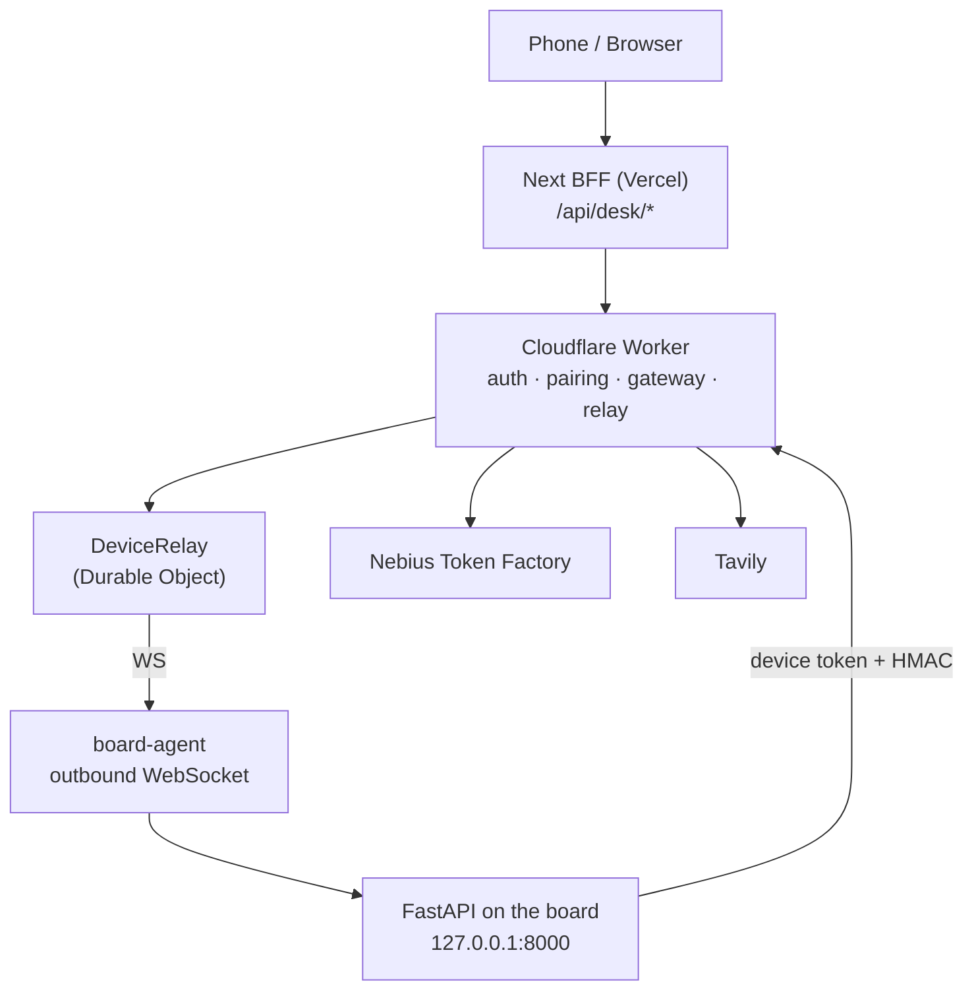
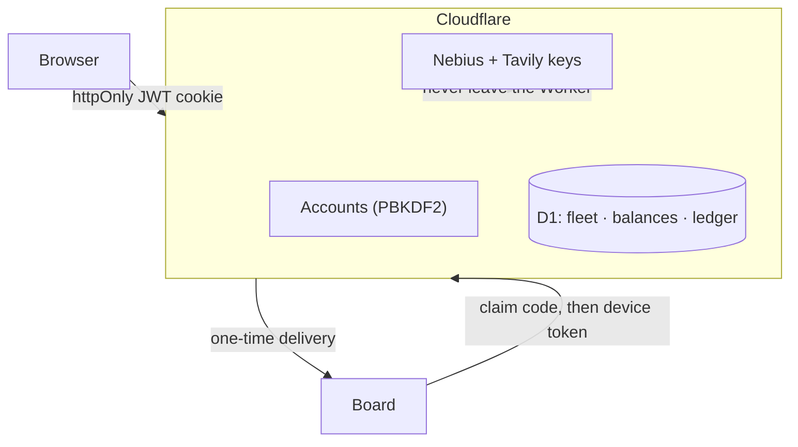

# Nebius Desk — Architecture

A Claude-style **operator desk** for an NVIDIA Jetson (or a Docker `board-emu`).
Chat drives shell / files / browser / jobs **on your box**. Light work stays local
(Ollama on the GPU); hard work goes to **Nebius Token Factory** (Nemotron) under a
metered cloud credit. Cloudflare owns identity, fleet, and the Nebius/Tavily keys.

> The board is the product. Without a paired board the desk is just auth chrome.

## Apps

| App | Role | Runs on |
|---|---|---|
| `apps/api` | FastAPI on the board: auth, hybrid LLM router, chat + desk tools, edge FS/CLI, browser, jobs, vault, telemetry | Jetson / board-emu |
| `apps/web` | Next.js 15 desk UI (the real product surface), proxies to cloud via `/api/desk/*` | Vercel |
| `apps/cloud` | Cloudflare Worker + D1 + Durable Object relay: accounts, pairing, gateway metering, guide stream, ops | Cloudflare |
| `apps/board-agent` | Long-lived Python agent that dials **out** and proxies cloud → `127.0.0.1:8000` | Board |
| `apps/board-emu` | Docker fake boards (Natasha/Nova/Orin). Nebius-only, no Ollama/CUDA | Docker |
| `apps/mobile` | Expo 52 thin client: login, chat, pair, machine CLI/files/terminal | Phone |

## Request path



The board never opens an inbound port. It dials **out** to `/v1/agent/connect`, and
the relay proxies `/v1/devices/{id}/*` back down the same socket.

## The model ladder

The point of the Jetson is cost control: answer free when possible, pick the
cheapest capable cloud tier, and shrink the prompt before paid tokens leave the board.

| Tier | Where | Default model | Job |
|---|---|---|---|
| `local` | Ollama on Jetson GPU | `qwen2.5:1.5b` | greetings, translate/format, short rewrites, **routing**, **history compression** |
| `nano` | Nebius | Nemotron 3 Nano | cheapest cloud; **Millie guide always**; board-emu fallback |
| `fast` | Nebius | Nemotron 3.5 Lightning | everyday Q&A, code help, summaries |
| `heavy` | Nebius | Nemotron 3 Super | hard reasoning / debug (`enable_thinking`) |
| `ultra` | Nebius | Nemotron Ultra | manual only (composer) |

One turn (`chat/turns.py` → `router/hybrid.py`):

1. Load device memory + desk context.
2. **Pick a tier** — manual composer choice, else rules (`router/intent.py`); borderline
   mid-length asks get a JSON route from the **local Qwen** (`router/selector.py`).
3. Cloud + long history → the local Qwen **compresses** older turns (`router/context.py`).
4. Budget / subscription check → over budget stays local or refuses.
5. Stream from Ollama **or** Nebius (usually via the cloud gateway).
6. Optional desk tools, then a follow-up model turn with the observations.
7. Telemetry records tokens / cost / route for the UI badge.

`LLM_MODE`: `hybrid` (default) · `local_only` · `cloud_only`.

## Millie, the guide

Millie is the on-screen 3D guide (three.js + VRM avatar) docked in the corner of the desk.
She is deliberately **not** a general chat model: she always runs on the `nano` tier and
each turn is one warm spoken sentence plus exactly one `guide` JSON fence of actions.

- **Frontend** — `apps/web/src/features/millie/`: overlay + canvas, the static 9-step tour
  (`millieTour.ts`, no LLM, no tokens), and safe clip/emotion whitelists (`safeMotion.ts`).
- **Backend** — `apps/api/app/guide/` (`prompt.py`, `actions.py`, `routes.py`, `turns.py`);
  the cloud Worker is the primary path (`apps/cloud/src/guide/`).
- **Action allowlist** — `open_*` screens, `highlight` targets, and `react` emotions are
  validated server-side (`guide/actions.py`) and again in the UI (`guideActions.ts`), so
  model output can only navigate and point — never execute shell or write files.
- **Vocabulary** — 18 emotions + 7 safe clips, kept in sync between `GUIDE_EMOTIONS`
  (API) and `SAFE_REACTIONS` / `SAFE_CLIPS` (web).
- **Entry points** — `/tour` (manual), `/autotour` (hands-free), and *introduce yourself*.

## Auth, pairing, security



- **Product login** = Cloudflare (short-lived JWT + refresh, optional TOTP). Web uses
  httpOnly cookies via the BFF; keys never reach the browser.
- **Pairing** = board shows a short code → user claims it in the UI → board receives a
  one-time `device_token` → dials the relay. The cloud only stores the token **hash**.
- **Keys** (Nebius, Tavily) live in the Worker gateway. The board never holds them.
- **Human brakes**: approval cards for sensitive shell/writes, no free sudo, and
  `install` refuses typosquats / `curl|bash` from unknown hosts (see `safe_install.py`).
- Gateway HMAC (`X-Desk-Signature`) is optional, can be made required.

## Folder map

```
Nebius Desk/
├── apps/
│   ├── api/            # FastAPI on the board
│   │   ├── app/
│   │   │   ├── auth/ router/ chat/ sessions/ telemetry/ tools/
│   │   │   ├── browser/ jobs/ ops/ vault/ brains/ guide/ devices/
│   │   │   ├── edge/       # files · cli · services · preview · monitor
│   │   │   ├── setup/      # pairing · wifi · cors
│   │   │   └── subscription/
│   │   └── tests/          # e2e suites (P0 tools, P1 jobs, P2 platform, P3 browser)
│   ├── web/            # Next 15 desk UI
│   │   └── src/{app,features,lib,shared,ui}
│   ├── cloud/          # Cloudflare Worker + D1 + DeviceRelay
│   ├── board-agent/    # outbound WS agent (desk_agent.py + systemd unit)
│   ├── board-emu/      # Docker fake boards
│   └── mobile/         # Expo client
├── packages/shared/    # API client + types
├── scripts/            # local operator scripts (gitignored)
└── docs/               # this file + API.md
```

## Money (enforced, not folklore)

| Meter | Cap | Where |
|---|---|---|
| Cloud Nebius credit | **$3.00** per plan | D1 `usage_ledger`; gateway returns `402` when spent |
| Soft daily Nebius (local) | **$2.00** | `nebius_daily_budget_usd` in `config.py` |
| Tavily plan credits | **500** | subscription catalog |
| Tavily key lifetime | **1500** | `wrangler.toml` + API cap |
| Local desk / CLI / files / memory | unlimited | not metered |

One plan: `desk` / "Per Jetson". Bootstrap auto-creates it. **No Stripe, no SKUs.**

## Deploy map

| Piece | Where | How |
|---|---|---|
| `apps/web` | Vercel | `vercel.json` → `framework: nextjs`; BFF proxies to the Worker |
| `apps/cloud` | Cloudflare Workers | `wrangler.toml` (D1 `nebius-desk`, DO `DeviceRelay`) |
| `apps/api` | Jetson / board-emu | uvicorn + `board-agent` systemd; pairs outbound |
| `apps/mobile` | Expo Go / EAS | defaults to the Worker URL |

See [API.md](./API.md) for lanes, CORS, HMAC, and ops traces.
