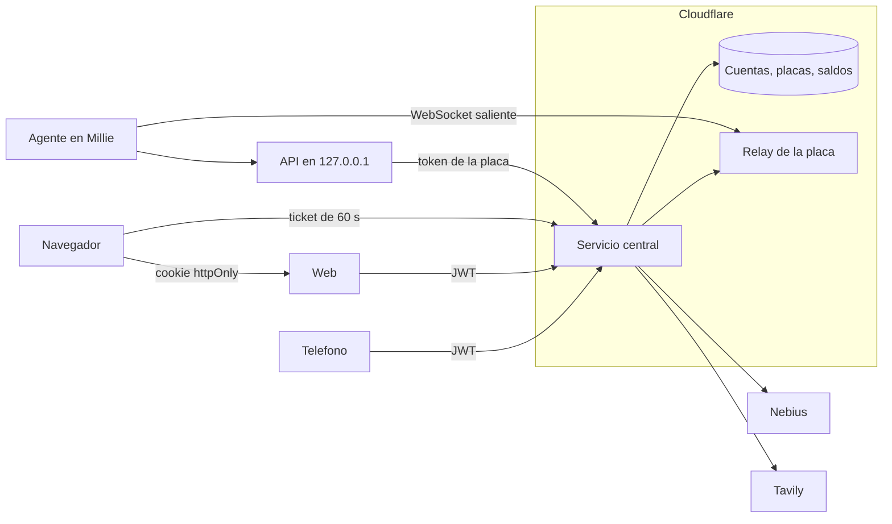

# Conexiones

El teléfono y el navegador hablan con un solo servicio en Cloudflare. Millie abre la conexión hacia afuera. Las claves de Nebius y de Tavily no salen de ese servicio.

Una petición de chat pasa por la web, que añade el JWT. El servicio comprueba que la cuenta es dueña de la placa y que el acceso remoto está encendido. El relay se la entrega al agente. El agente la repite en la API local. Si hace falta Nebius o Tavily, la placa llama al gateway y el servicio usa las claves.

## Credenciales

| Credencial | Dónde está | Cómo se guarda |
|---|---|---|
| Contraseña de la cuenta | Cloudflare | PBKDF2 |
| Sesión web | Cookie httpOnly | JWT de 15 minutos. El refresco rota y solo se guarda su hash |
| Sesión del teléfono | Almacén seguro del teléfono | El mismo JWT |
| Token de la placa | Millie, archivo con permiso 600 | En la nube solo el hash. Se entrega una vez |
| Secreto del agente | Solo en Millie | La API local lo acepta únicamente desde el agente |
| Ticket de terminal | El navegador, 60 segundos | Un solo uso |
| Claves de Nebius y Tavily | Secretos del servicio | La placa no las tiene |

Millie no abre puertos. Emparejar exige un código corto que se confirma con la sesión ya abierta. Cada búsqueda de Tavily se reserva antes de llamarla, contra los 500 del plan y el tope de 1500 de la clave. Nebius se cobra con el uso real del stream.

El servicio está en `https://nebius-desk-cloud.devops-640.workers.dev`.
